# J.A.R.V.I.S. · Sistema de Logística de Monedas Inteligentes

**Universidad Militar Nueva Granada · Ingeniería Mecatrónica · Campus Cajicá**<br>
**Asignatura:** Micros y Laboratorio · **Grupo 3** · Etapa final<br>
**Elemento diferencial:** agente de IA conversacional tipo **J.A.R.V.I.S.** que supervisa y comanda toda la planta

**Integrantes**

- Faber Alexander Rodríguez Hernández
- David Felipe Farfán Quiroz
- Kevin Philip Castelblanco Ramírez

---

Sistema logístico de monedas colombianas construido alrededor de **cuatro microcontroladores ESP32** conectados por WiFi:

1. Una **banda transportadora** lleva cada moneda bajo una **ESP32-CAM**.
2. En el PC, una red neuronal **YOLO11** reconoce las **9 monedas en circulación** (nuevas y antiguas), varias a la vez.
3. El sistema cuenta cada moneda una sola vez y calcula **valor, cantidad y peso**.
4. Le ordena a una **ESP32-S3** mover el **servomotor** que empuja la moneda a su **vaso**.
5. Los vasos viajan en un **carrito 4WD** manejado desde la misma interfaz.
6. Todo se supervisa en un **dashboard tipo HUD** donde **JARVIS** responde por voz cualquier pregunta sobre el proyecto (estado en vivo, código, firmware, piezas, componentes) y ejecuta órdenes seguras.

https://github.com/user-attachments/assets/4e56124d-85ef-467f-95f0-0e9ebe2942c4

| Módulo | Microcontrolador | Qué hace | Estado |
|---|---|---|---|
| Banda transportadora | ESP32-S3 | Motor DC con PWM a través de un TIP31C | **Construida y funcionando** |
| Estación de visión | ESP32-CAM (OV5640) | Video MJPEG por WiFi desde un soporte impreso en 3D | **Construida y funcionando** |
| Reconocimiento y conteo | PC (YOLO11n) | Detecta varias monedas a la vez y las cuenta una sola vez | **Funcionando** (mAP50 = 0,995) |
| Clasificación | ESP32-S3 + 4 servos SG90 | Desvía cada moneda a su vaso, con cola y retardo por servo | **Construida y funcionando** |
| Transporte | ESP32 DevKit + L298N | Carrito 4WD manejado desde la interfaz o el celular | **Construido y funcionando** |
| Dron | ESP32-C3 SuperMini | Vuelo de 1 m a 1,20 m con detección de obstáculo | Diseñado, simulado y construido (sin telemetría en vivo) |
| Dashboard + JARVIS | PC (FastAPI + Gemini) | Interfaz HUD, voz, órdenes, avisos y bitácora | **Funcionando** |

---

## Contenido

1. [Arquitectura del sistema](#1-arquitectura-del-sistema)
2. [La ESP32: por qué es el corazón del proyecto](#2-la-esp32-por-qué-es-el-corazón-del-proyecto)
3. [Análisis por etapa: mecánico, eléctrico y software](#3-análisis-por-etapa-mecánico-eléctrico-y-software)
   - [Etapa 1 · Banda transportadora](#etapa-1--banda-transportadora)
   - [Etapa 2 · Estación de visión ESP32-CAM](#etapa-2--estación-de-visión-esp32-cam)
   - [Etapa 3 · Reconocimiento y conteo en el PC](#etapa-3--reconocimiento-y-conteo-en-el-pc)
   - [Etapa 4 · Clasificación con ESP32-S3 y servos](#etapa-4--clasificación-con-esp32-s3-y-servos)
   - [Etapa 5 · Carrito de transporte 4WD](#etapa-5--carrito-de-transporte-4wd)
   - [Etapa 6 · Dron](#etapa-6--dron)
   - [Etapa 7 · Dashboard HUD y agente JARVIS](#etapa-7--dashboard-hud-y-agente-jarvis)
4. [Análisis del proyecto](#4-análisis-del-proyecto)
5. [Paso a paso para replicarlo](#5-paso-a-paso-para-replicarlo)
6. [Estructura del repositorio](#6-estructura-del-repositorio)
7. [Evidencias](#7-evidencias)
8. [Conclusiones](#8-conclusiones)
9. [Referencias](#9-referencias)

---

## 1. Arquitectura del sistema

### 1.1 Diagrama de bloques general

Cada módulo tiene su propio microcontrolador y todos se comunican por **WiFi en la misma red**. La regla de diseño fue
**separar el tiempo real del cómputo pesado**:

- **Las ESP32** se encargan del hardware: cámara, motor, servos, puente H y sensores.
- **El PC** se encarga del cómputo pesado: visión artificial, conteo, interfaz y JARVIS.

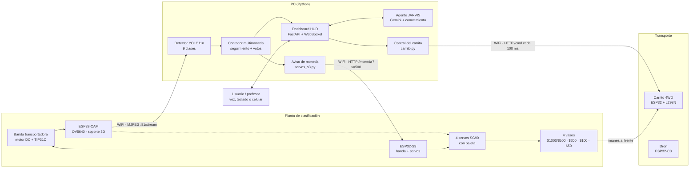

### 1.2 Recorrido de una moneda

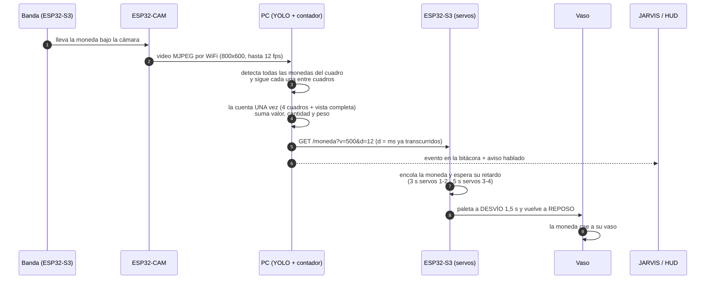

### 1.3 Red y protocolos

| Enlace | Medio | Protocolo / ruta | Uso |
|---|---|---|---|
| ESP32-CAM → PC | WiFi 2,4 GHz | HTTP MJPEG `:81/stream`, ajustes en `/control` | Video para la IA |
| PC → ESP32-S3 | WiFi (mDNS `banda-s3.local`) | `GET /moneda?v=&d=`, `/banda?v=`, `/probar?s=`, `/estado` | Clasificación y banda |
| PC → carrito | WiFi (mDNS `carrito-g3.local`) | `GET /cmd?d=F&s=50` cada 100 ms, `/ping` | Manejo del carrito |
| Celular → carrito | Red propia `Carrito_G3` | Página web en `192.168.4.1` | Control alterno |
| PC → navegador | Red local | HTTP + **WebSocket** (estado cada 0,1 s) + MJPEG anotado | Dashboard |
| PC ↔ Google | Internet | Gemini API (streaming SSE) | Razonamiento de JARVIS |

Las ESP32-S3 y del carrito funcionan en modo **AP + estación**: entran al WiFi del grupo para hablar con el PC y además
conservan su red propia como respaldo.

### 1.4 Arquitectura de software del PC

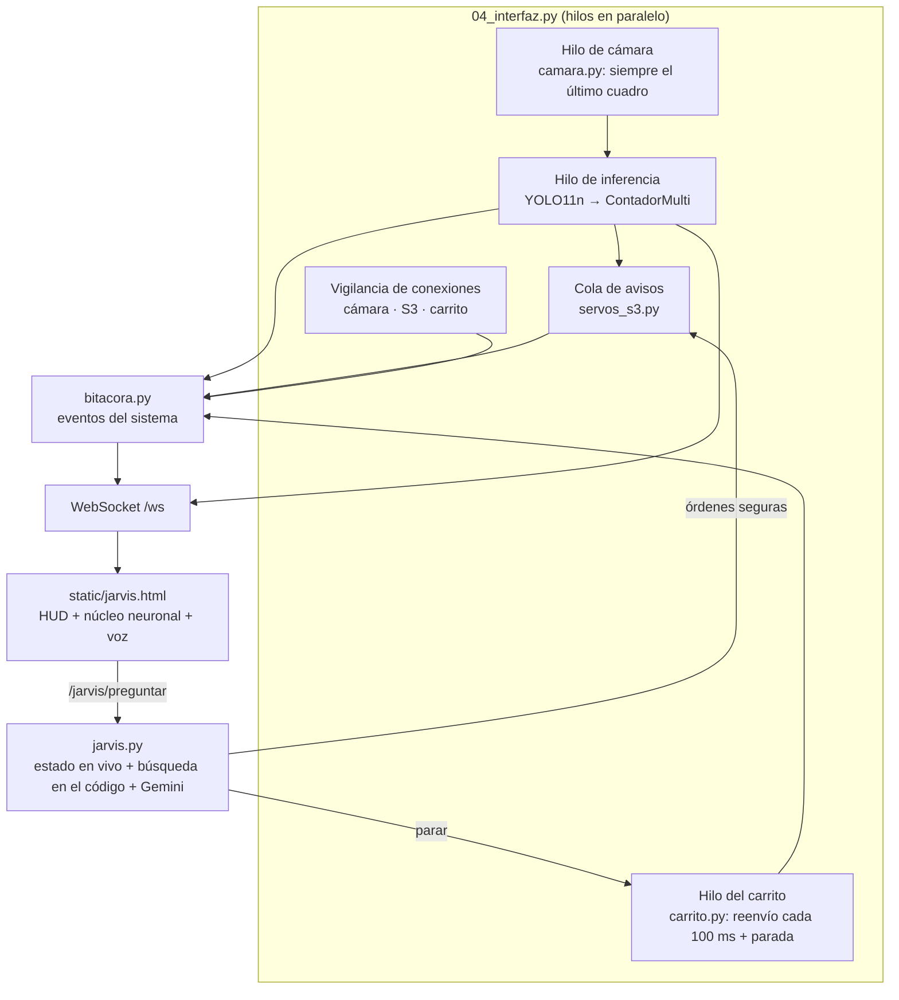

---

## 2. La ESP32: por qué es el corazón del proyecto

El proyecto usa **cuatro variantes de la familia ESP32**, una por módulo. La razón es que una sola familia de
microcontroladores trae, en un chip de bajo costo, todo lo que el sistema necesita:

- **WiFi integrado.** Es el único medio de comunicación de todo el sistema; no se usó ningún cable de datos entre módulos.
- **PWM por hardware (LEDC).** Tiene hasta 16 canales con frecuencia y resolución configurables para motor, servos y LEDs.
- **Doble núcleo a 240 MHz y PSRAM.** Atiende la cámara, el servidor web y el WiFi al mismo tiempo.
- **Memoria no volátil (NVS) y mDNS.** Guarda la calibración y deja que el PC encuentre las placas por su nombre.

| Placa | Módulo | Recursos de la ESP32 que se aprovechan |
|---|---|---|
| **ESP32-CAM AI-Thinker** (OV5640) | Visión | Interfaz de cámara DVP, **PSRAM** para dos buffers JPEG, compresión JPEG por hardware del sensor, servidor HTTP con stream MJPEG, LEDC para el flash |
| **ESP32-S3 DevKit** | Banda + clasificación | **5 canales PWM** (motor a 1 kHz/10 bits y 4 servos a 50 Hz/14 bits), servidor web, **NVS** para la calibración, **mDNS** `banda-s3.local`, cola de tareas sin bloquear con `millis()` |
| **ESP32 DevKit V1** | Carrito 4WD | 2 PWM + 4 GPIO hacia el L298N, modo **AP + estación**, parada de seguridad por *watchdog* de software (400 ms), mDNS `carrito-g3.local` |
| **ESP32-C3 SuperMini** | Dron | Núcleo RISC-V de bajo peso y consumo, WiFi para reportar a JARVIS |

**Comparación con otras opciones que se consideraron**

| Criterio | ESP32 | Arduino UNO | Raspberry Pi |
|---|---|---|---|
| WiFi | Integrado | Requiere módulo externo | Integrado |
| Cámara | ESP32-CAM lista con PSRAM | No | Sí, pero más costosa |
| PWM por hardware | 16 canales LEDC | 6 canales fijos de 8 bits | Pocos canales por hardware |
| Tiempo real | Sí (sin sistema operativo pesado) | Sí | No garantizado (Linux) |
| Costo y tamaño | Bajo, cabe en el dron | Bajo, sin red | Alto para 4 módulos |

**La ESP32 hizo posible la arquitectura distribuida.** Cada módulo es independiente y se prueba por separado. El PC solo
"habla HTTP" con cada placa. Por eso cambiar el modelo de IA o la interfaz nunca obligó a tocar el firmware, y viceversa.

---

## 3. Análisis por etapa: mecánico, eléctrico y software

### Etapa 1 · Banda transportadora

**Mecánico**
- Estructura de **MDF de 3 mm** con banda de **cuerina**. Ancho exterior de unos 9,5 cm. Las paredes laterales tienen
  ranuras rectangulares de 3,5 cm separadas 9 cm, que sirven para fijar el soporte de la cámara y las paletas.
- Primero se simuló una planta en L con brazos robóticos de 3 GDL (PyBullet, `simulacion/`). La simulación mostró que
  unos **servos con paleta** sobre una **banda recta** clasifican igual de bien con mucho menos hardware. Esa fue la
  versión que se construyó.

**Eléctrico**
- Motor DC de la banda manejado por la **ESP32-S3** con un transistor de potencia **TIP31C** como interruptor:
  `GPIO 4 → 150 Ω → base del TIP31C`; el colector va al motor (−) y el emisor a GND común.
- **Diodo 1N4007 de rueda libre** en paralelo con el motor, para absorber el pico de tensión inductivo al cortar el PWM.
- Corriente de base estimada: `I_B ≈ (3,3 V − 0,8 V) / 150 Ω ≈ 17 mA`, dentro de lo que entrega un GPIO. Con la ganancia
  mínima del TIP31C (≈ 25) el transistor puede saturar con unos `25 × 17 mA ≈ 0,4 A`, suficiente para el motor pequeño de
  la banda.

**Software** (`firmware/esp32s3_banda_servos/BandaServos_S3/BandaServos_S3.ino`)
- PWM a **1 kHz con 10 bits** (0–1023).
- Al arrancar da un **empujón de 150 ms al 100 %** para vencer la fricción estática y luego queda al **50 %**.
- La velocidad se cambia desde la página de la S3, desde el dashboard o por voz con JARVIS ("banda al 40 por ciento"),
  y se guarda en NVS.

---

### Etapa 2 · Estación de visión ESP32-CAM

**Mecánico**
- **Soporte diseñado por el grupo** en CAD (CadQuery → STEP para SolidWorks y STL para imprimir), impreso en **PLA**.
  Los archivos están en `cad/soporte_esp32cam/`. Tiene tres piezas:
  - un **túnel** que cubre un tramo de la banda y bloquea la luz exterior;
  - una **tapa**;
  - un **carro** donde va la ESP32-CAM con su placa ESP32-CAM-MB mirando hacia abajo.
- La cámara queda a **altura fija**, así que cada moneda aparece siempre con el mismo tamaño en la imagen
  (de ~80 a 420 px de diámetro en 800×600). La detección y el etiquetado automático aprovechan eso.

**Eléctrico**
- ESP32-CAM AI-Thinker con sensor **OV5640** y lente normal, alimentada a 5 V por la placa MB.
- Por el calentamiento se le puso un **disipador**, y en el firmware se bajó la CPU a 160 MHz, el video a 12 fps y la
  potencia WiFi a 15 dBm.
- **Iluminación con LEDs de ambiente** dentro del túnel y el **flash de la placa siempre apagado**: la luz es pareja y sin
  reflejos puntuales.

**Software** (`firmware/esp32cam/ESP32CAM_Monedas_v2/ESP32CAM_Monedas_v2.ino`)
- Resolución **SVGA 800×600**, JPEG calidad 8 para conservar el relieve, **2 buffers en PSRAM** y siempre el cuadro más
  nuevo (`CAMERA_GRAB_LATEST`), sin retraso acumulado.
- Rutas: `/` página, `:81/stream` MJPEG, `/capture` foto, `/control?var=&val=` ajustes y `/status`.
- **Bug resuelto:** el flash se apagaba a los 2 s porque compartía el temporizador LEDC con el reloj XCLK de la cámara.
  Se le asignó un temporizador y un canal propios (timer 3, canal 7).

---

### Etapa 3 · Reconocimiento y conteo en el PC

**Datos y etiquetado automático** (`vision/01_capturar_deteccion.py`, `vision/etiquetado.py`)
- Las fotos se tomaron con la **misma ESP32-CAM ya montada en la banda**: unas **609 fotos**, al menos 60 por moneda.
- Las cajas de cada moneda se etiquetan **solas por sustracción de fondo**:
  1. 30 fotos de la banda vacía forman un **fondo de referencia** (mediana).
  2. Un **k-means** encuentra la zona de la banda, se **iguala la exposición automática** y lo que cambia contra el fondo
     es moneda.
  3. Filtros: diámetro de 80 a 420 px, redondez ≥ 0,78, y descarte de reflejos en las paredes.
- `vision/02_preparar_deteccion.py` genera **1.800 composiciones sintéticas**: pega de 2 a 6 monedas recortadas, de
  distintas denominaciones y a veces casi tocándose, sobre fotos de la banda vacía. Así el modelo aprende a ver
  **varias monedas mezcladas** aunque cada foto se tomó con una sola denominación.

**Modelo** (`vision/03_entrenar_deteccion.py`)
- **YOLO11n** (detección de objetos) preentrenado, ajustado con **9 clases**: $1.000 nueva, $500 nueva/antigua,
  $200 nueva/antigua, $100 nueva/antigua y $50 nueva/antigua.
- Entrenado en la **GPU** del PC: **60 épocas a 640 px**, lote de 16, en unos **32 minutos**.
  Datos: 2.341 imágenes de entrenamiento y 323 de validación.

| Métrica (validación, última época) | Valor |
|---|---|
| Precisión | **0,9997** |
| Recall | **1,000** |
| mAP50 | **0,995** |
| mAP50-95 | **0,993** |

<p align="center">
  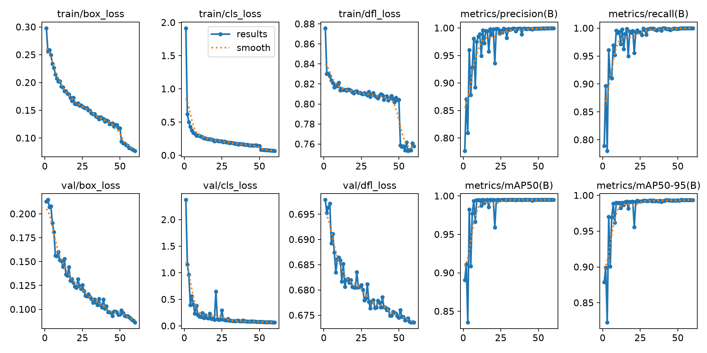<br>
  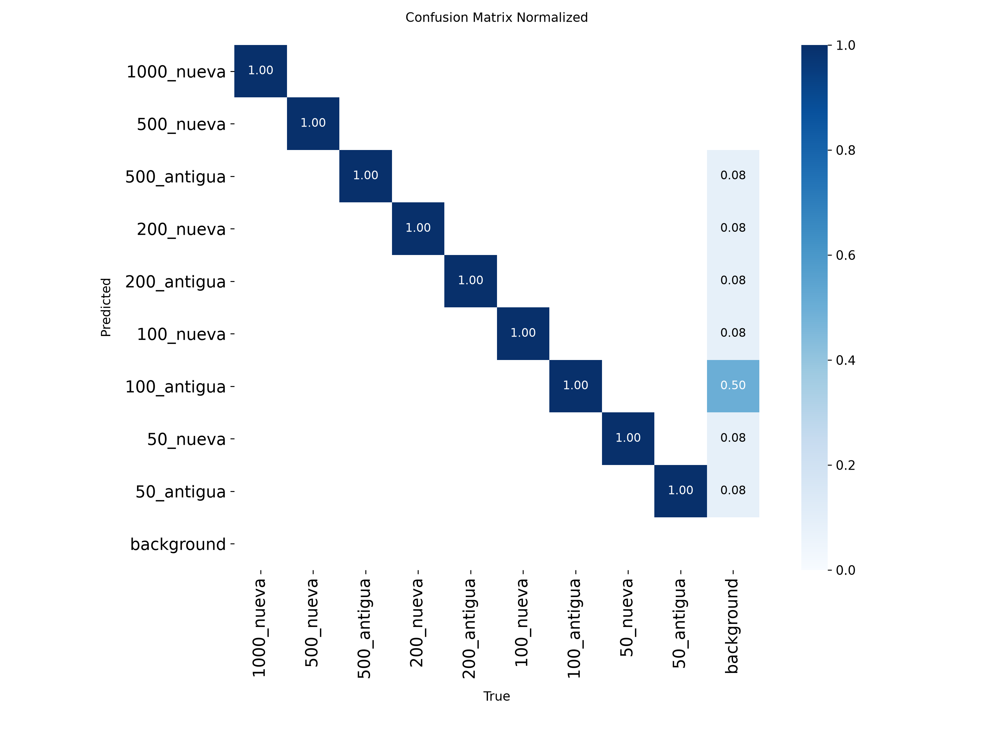
  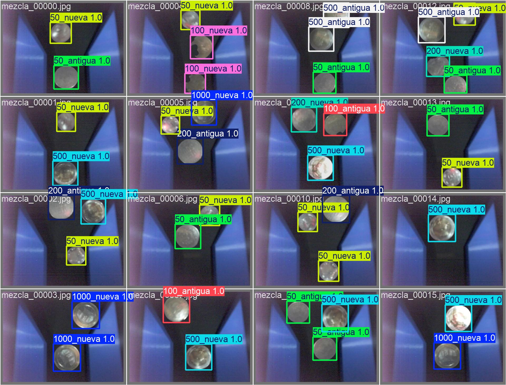
</p>

> **Lectura honesta de las métricas.** La validación mezcla fotos reales apartadas y composiciones sintéticas tomadas
> con la misma cámara e iluminación; por eso los valores son tan altos. La prueba que valida el sistema es el
> funcionamiento en vivo sobre la banda (ver [evidencias](#7-evidencias)).

**Contador multimoneda** (`vision/contador_multi.py`)
- **Seguimiento:** cada detección se une a la moneda más cercana del cuadro anterior, así cada moneda tiene su número (#id).
- **Votos:** cada moneda acumula votos por clase ponderados por la confianza; un cuadro dudoso no cambia su denominación.
  Una moneda cortada por el borde vota con peso 0,3.
- **Conteo único:** se cuenta cuando se vio en **4 cuadros** y al menos una vez **completa**. Con la cámara a ~12 fps
  eso tarda unos **0,3 s** desde que la moneda entra.
- **Peso:** cada moneda contada suma su masa aproximada:

| Moneda | Masa aprox. | Vaso / servo |
|---|---|---|
| $1.000 nueva | 9,32 g | 1 |
| $500 nueva / antigua | 7,14 g / 7,11 g | 1 |
| $200 nueva / antigua | 4,61 g / 7,10 g | 2 |
| $100 nueva / antigua | 3,34 g / 5,25 g | 3 |
| $50 nueva / antigua | 2,00 g / 4,50 g | 4 |

*Masas calculadas con la guía de empaque de moneda del Banco de la República (peso de la bolsa ÷ cantidad).*

---

### Etapa 4 · Clasificación con ESP32-S3 y servos

**Mecánico**
- Hay **4 servos SG90 con paleta**, uno por vaso, a lo largo de la banda. Cada paleta tiene dos posiciones:
  - **REPOSO:** apartada, la moneda sigue de largo;
  - **DESVÍO:** cruzada, la moneda cae a su vaso.
- Los **4 vasos** están impresos en PLA (radio de ~3 cm, alto de ~5 cm): $1.000 y $500, $200, $100 y $50. Cada vaso
  recibe la versión nueva y la antigua de su denominación.
- Los ángulos se **calibraron en la planta real** con una página web propia que mueve cada servo en vivo:

| Servo | GPIO | Vaso | Reposo | Desvío | Retardo desde la detección |
|---|---|---|---|---|---|
| 1 | 5 | $1.000 y $500 | 47° | 120° | 3,0 s |
| 2 | 6 | $200 | 180° | 116° | 3,0 s |
| 3 | 7 | $100 | 90° | 50° | 5,0 s |
| 4 | 15 | $50 | 0° | 50° | 5,0 s |

El retardo es el tiempo que tarda la moneda en viajar de la cámara a su paleta. Los servos 3 y 4 están más lejos, así
que esperan más.

**Eléctrico**
- Los servos se alimentan con una **fuente de 5 V aparte (≥ 2 A)**. Al moverse juntos, cuatro SG90 piden picos de
  corriente que el regulador de la placa no soporta. Las tierras van unidas (masa común) y hay un **condensador de
  470–1000 µF** junto a los servos para que la S3 no se reinicie.
- La señal de 3,3 V de la S3 es suficiente para el SG90. Los pines se eligieron evitando los de arranque de la S3
  (0, 3, 45, 46) y el GPIO 4 del motor.
- **PWM de los servos:** 50 Hz (período de 20 ms) con 14 bits, es decir 1 cuenta ≈ 1,22 µs. El pulso va de 500 µs (0°)
  a 2400 µs (180°), unas 1.556 cuentas útiles: **≈ 0,12° por cuenta**, muy por debajo de la precisión mecánica del SG90.

**Software** (`firmware/esp32s3_banda_servos/BandaServos_S3/BandaServos_S3.ino`)
- `/moneda?v=500&d=12`: la S3 elige el servo según el valor (`servoDeValor`), descuenta los `d` ms que la orden tardó en
  llegar y la mete en una **cola de hasta 24 monedas**.
- `atenderCola()` corre en cada vuelta del `loop()`: activa cada paleta a su hora y la regresa tras 1,5 s,
  **sin usar `delay()`**, así el servidor web y la banda nunca se bloquean. Si llega otra moneda mientras la paleta está
  desviada, el desvío se alarga.
- La calibración y los retardos se guardan en **NVS (Preferences)**. Hay una página de calibración propia en
  `http://banda-s3.local` y, si falla el WiFi, una red de respaldo `Servos-Monedas`.
- En el PC, `vision/servos_s3.py` envía los avisos en un hilo aparte, con un reintento. Descarta avisos de más de 2 s
  (llegarían tarde a la paleta) y lee `/estado` cada 2 s para mostrar en el dashboard el ángulo real de cada servo.

---

### Etapa 5 · Carrito de transporte 4WD

**Mecánico**
- Chasis 4WD de acrílico de **dos pisos** con 4 motorreductores **TT 1:48**. La tracción es diferencial (tipo tanque).
- **Imanes al frente** para llevar hasta 2 vasos. En el segundo piso va la **base del dron**.

**Eléctrico**
- **ESP32 DevKit V1** + puente H **L298N**:

| ESP32 | L298N | Función |
|---|---|---|
| D13 | ENA | PWM lado izquierdo |
| D27 / D26 | IN1 / IN2 | Sentido izquierdo |
| D25 / D33 | IN3 / IN4 | Sentido derecho |
| D32 | ENB | PWM lado derecho |

- La batería **Ni-MH de 7,2 V y 500 mAh** alimenta los motores y un **power bank** aparte alimenta la ESP32. Cuando
  todo iba en la misma batería, la ESP32 se reiniciaba al arrancar los motores. La tierra es común.
- El L298N (bipolar) pierde ≈ 1,8–2 V. Con la batería cargada llegan unos 5,9 V a los motores TT, dentro de su rango.
- Esquema completo: `docs/carrito/img/esquema_electrico.png`.

**Software** (`firmware/carrito/src/main.cpp`, PlatformIO)
- Órdenes `GET /cmd?d=F|B|L|R|FL|FR|BL|BR|S|X&s=0-100`.
- **Rampas de aceleración**: sube suave y frena más rápido, para no tumbar los vasos.
- **Zona muerta**: el PWM nunca baja de 90/255 cuando debe moverse, porque por debajo los motores zumban sin girar.
- **Parada de seguridad**: si pasan **400 ms sin órdenes**, se detiene solo.
- Modo **AP + estación**: red propia `Carrito_G3` para el celular y, a la vez, el WiFi del grupo para el dashboard.
- En el PC, `vision/carrito.py` reenvía la orden cada 100 ms mientras se mantiene el botón (o la tecla). Si la página
  deja de mandar por 0,35 s, frena el carrito. Así hay **dos capas de seguridad**, la del PC y la del firmware.
  También registra cada movimiento (dirección, velocidad, duración) para que JARVIS pueda responder hacia dónde fue
  el carrito.
- Se simuló en **Wokwi**, con LEDs en lugar del L298N y un analizador lógico (`firmware/carrito/diagram.json`).

<p align="center">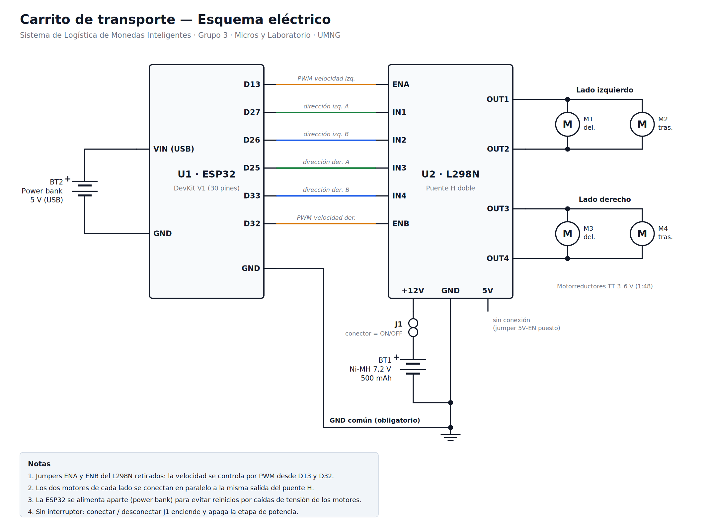</p>

---

### Etapa 6 · Dron

**Diseño y simulación** (`simulacion/dron/`)
- Modelo URDF propio y **control PID en cascada**: posición → velocidad → ángulo → empuje, con altura PID 12/3/5 y un
  mezclador en X.
- Misión simulada:
  1. despega a 1,20 m;
  2. vuela 1 m hasta el punto B;
  3. entrega;
  4. retorna y aterriza.
  Duración total: **14,5 s**, con error de entrega de **3,3 cm**.
- El diseño original usaba ESP32-S3 SuperMini, 4 motores coreless **8520** con hélices de 75 mm, MPU6050, VL53L0X
  (altura), IR FC-51 (obstáculos) y LiPo 1S. Daba **T/W = 2,28** con 10 g de carga y costaba **$170.200 COP**
  (presupuesto en `simulacion/dron/Presupuesto_Dron_Monedas_v2.xlsx`).

**Lo que se construyó**
- **ESP32-C3 SuperMini**, motores **615** (no se consiguieron los 8520), batería de 500 mAh y un **chasis más ligero**
  impreso en 3D para que vuele con esos motores.
- No transporta carga: vuela el trayecto, detecta el obstáculo y lo reporta. Las monedas viajan en los vasos del carrito.
- Limitación conocida: sin sensor de flujo óptico (descartado por costo) el dron deriva despacio en horizontal.

<p align="center">
  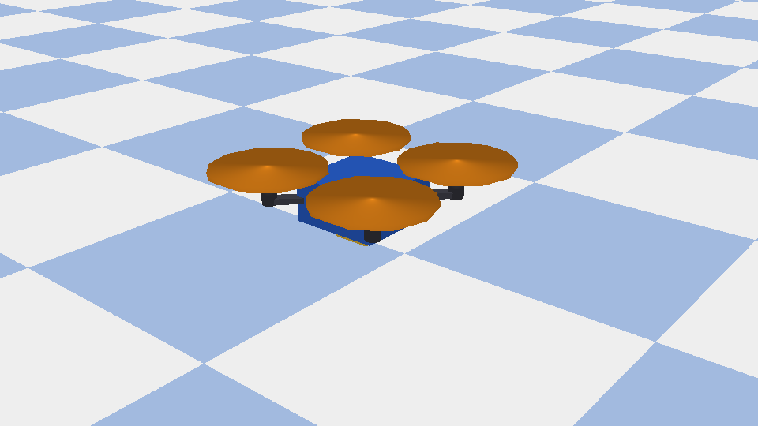
  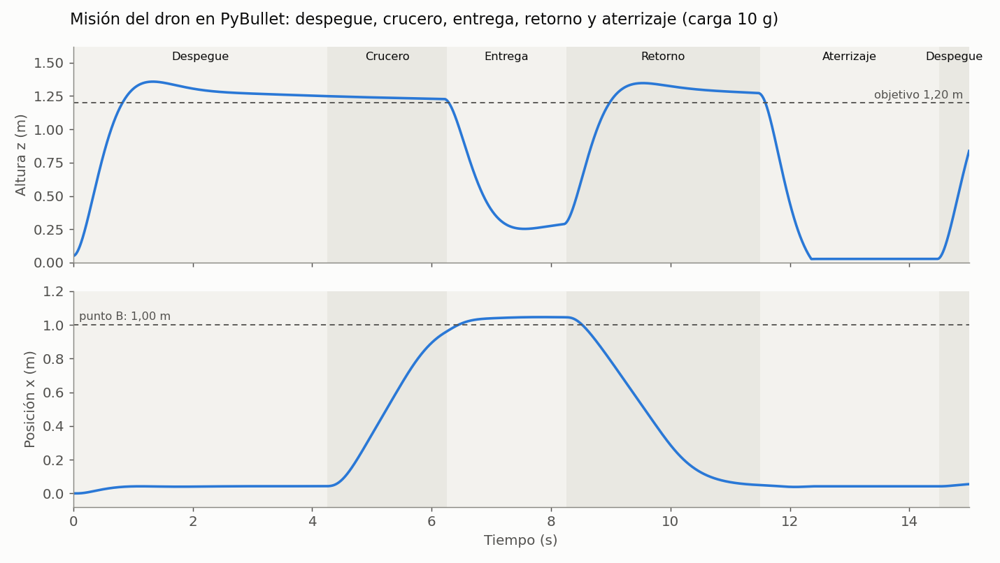
</p>

---

### Etapa 7 · Dashboard HUD y agente JARVIS

<p align="center">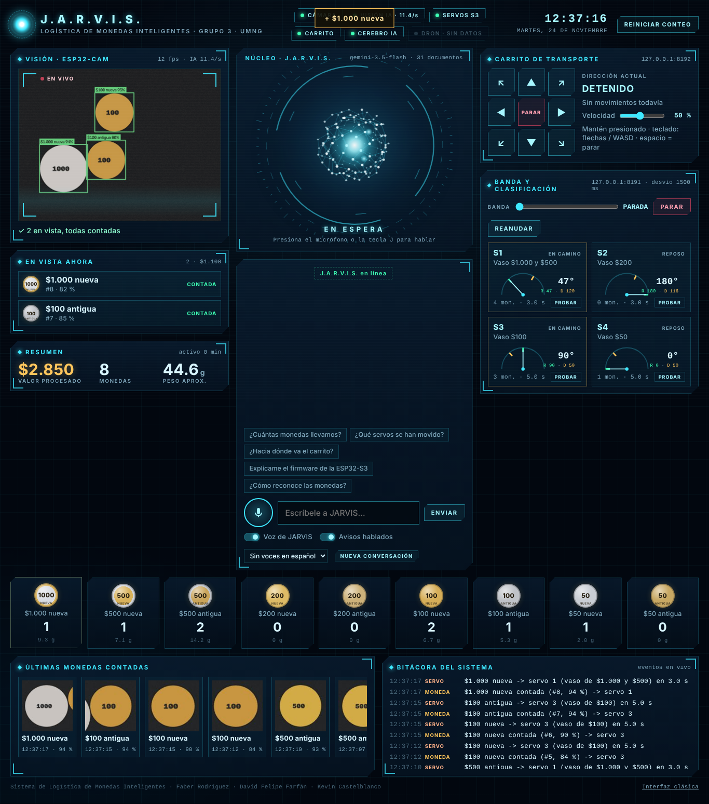</p>

*Dashboard en modo demo (`python 04_interfaz.py --demo`).*

**Dashboard** (`vision/04_interfaz.py`, `vision/static/jarvis.html`)
- Servidor **FastAPI** con WebSocket (estado cada 0,1 s) y video anotado.
- Pantalla estilo HUD:
  - **centro:** el núcleo neuronal de JARVIS, animado en *canvas*, que reacciona cuando escucha, piensa o habla;
  - **izquierda:** la cámara con las detecciones, las monedas en vista, y valor, cantidad y **peso**;
  - **derecha:** el carrito (cruceta, velocidad, dirección actual y último movimiento), la banda y los 4 servos, cada uno
    con un medidor de ángulo que se ilumina cuando desvía una moneda;
  - **abajo:** los contadores por moneda, el historial con la foto de cada moneda y la **bitácora** de eventos.

**JARVIS** (`vision/jarvis.py`)

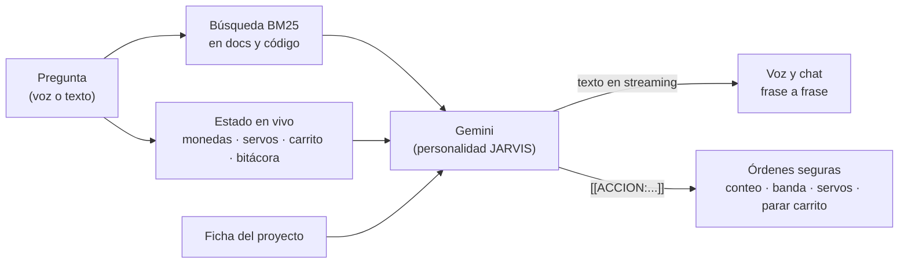

- **Conocimiento:** lee todo el código del proyecto (`vision/*.py` y el firmware), los documentos de
  `vision/conocimiento/` y la ficha del proyecto con su estado actual.
  1. En cada pregunta, una **búsqueda BM25** con sinónimos elige los fragmentos más relevantes. Por ejemplo, para
     "explícame el firmware de la S3" incluye el `.ino` completo.
  2. Le agrega el **estado en vivo** y lo envía a **Gemini** (plan gratuito, con cambio automático de modelo si se
     acaba la cuota).
- **Voz:** reconocimiento de voz del navegador (Chrome o Edge) con botón de micrófono o tecla **J**. La respuesta se
  **lee en voz alta frase a frase** mientras llega.
- **Órdenes seguras:** reiniciar el conteo, parar, reanudar o cambiar la velocidad de la banda, probar un servo, servos a
  reposo, parar el carrito y silenciar avisos. Por seguridad, **JARVIS no mueve el carrito**.
- **Avisos:** anuncia cada moneda contada y cualquier módulo que se desconecte o vuelva.
- **Robustez:**
  - sin internet o sin clave, responde con reglas locales (conteo, peso, carrito, servos, banda);
  - las **claves WiFi se borran** de cualquier archivo antes de enviarlo a la IA;
  - la clave de Gemini se guarda **fuera del repositorio**.

---

## 4. Análisis del proyecto

### 4.1 Decisiones de diseño

| Decisión | Alternativa descartada | Por qué |
|---|---|---|
| Reconocer en el PC con la ESP32-CAM como "ojo" | Validadores comerciales de monedas | Uno cuesta unos $150.000 y harían falta dos para 9 monedas; la cámara reconoce todas por menos |
| Detector YOLO11n (varias monedas) | Clasificador de una moneda (versión del parcial) | En la banda entran varias monedas a la vez |
| Etiquetado automático por sustracción de fondo | Etiquetar a mano | 609 fotos etiquetadas solas; solo había que elegir la moneda con una tecla |
| Composiciones sintéticas | Tomar fotos de todas las mezclas | Se fotografió una denominación a la vez y el modelo aprendió las mezclas |
| Servos con paleta en banda recta | Brazos de 3 GDL en L | La simulación mostró el mismo resultado con mucho menos hardware |
| Retardo por servo en la S3 | Un sensor por paleta | Con la banda a velocidad constante el tiempo de viaje es predecible y no se necesitan sensores extra |
| Cola sin `delay()` en la S3 | Mover el servo con `delay()` | Varias monedas seguidas no se pierden y el servidor sigue respondiendo |
| AP + estación en carrito y S3 | Solo red propia | El PC solo puede estar en una red: todos van al WiFi del grupo sin perder el respaldo |
| Electrónica de control con alimentación aparte | Una sola fuente | Era la causa de la mayoría de reinicios (cámara, carrito, servos) |
| JARVIS con búsqueda en el código + Gemini | Respuestas programadas | Responde preguntas abiertas del profesor citando archivos, pines y valores reales |

### 4.2 Problemas encontrados y soluciones

| Problema | Causa | Solución |
|---|---|---|
| ESP32-CAM muy caliente | CPU y WiFi al máximo | Disipador, 160 MHz, 12 fps y WiFi a 15 dBm |
| El flash se apagaba a los 2 s | Compartía el temporizador LEDC con la cámara | Temporizador y canal propios; después, LEDs de ambiente |
| Caracteres raros en el Monitor Serie | Monitor a 9600 y placa a 115200 | 115200 baudios |
| El PC no veía la cámara | Distintas redes WiFi | Todo en el mismo WiFi; IP del Monitor Serie en `config.py` |
| Monedas "fantasma" al capturar | Fondo viejo y exposición automática | Fondo nuevo, zona de banda e igualación de exposición |
| Cajas falsas en fotos de $50 | Reflejos en la pared del embudo | La caja debe estar dentro de la banda y ser casi cuadrada |
| Fotos borrosas | Enfoque del lente | Ajustar el lente; subir la resolución no ayudó |
| Servo 1 y motor en el mismo pin | Ambos en GPIO 4 | Servos a GPIO 5, 6, 7 y 15 |
| El PC no podía manejar el carrito | El carrito solo tenía su red propia | Modo AP + estación con mDNS |
| Reinicios del carrito | Caída de tensión de la batería | ESP32 con power bank y tierra común |

### 4.3 Tiempos del sistema

| Tramo | Tiempo aproximado |
|---|---|
| Video de la ESP32-CAM | Hasta 12 cuadros/s (≈ 83 ms por cuadro) |
| Confirmación de una moneda | 4 cuadros ≈ 0,3 s |
| Aviso PC → S3 por WiFi | Decenas de ms (se descuenta del retardo con el parámetro `d`) |
| Retardo hasta la paleta | 3 s (servos 1 y 2) · 5 s (servos 3 y 4) |
| Paleta en desvío | 1,5 s |
| Reenvío de órdenes al carrito | Cada 100 ms; parada a los 0,35 s (PC) o 0,4 s (firmware) |

### 4.4 Cumplimiento de los objetivos

| Objetivo | Cómo se cumplió |
|---|---|
| Arquitectura, requerimientos y selección de materiales | Diagramas de bloques por módulo (secciones 1 y 3), tablas de decisiones y de componentes |
| Diseño mecánico y electrónico propio | Soporte de cámara en CAD (STEP/STL), banda en MDF, vasos y paletas impresos, URDF de planta y dron, esquemas y tablas de pines |
| Módulos construidos y funcionando | Banda, visión, clasificación, carrito y dron construidos; planta y dron también simulados |
| App web inalámbrica con la ESP32 | Dashboard FastAPI que habla por WiFi con las tres ESP32 de la planta y el transporte |
| Contador con valor, cantidad y peso | Contador multimoneda en vivo con las tres variables |
| Chatbot asistente con los datos del proyecto | JARVIS con voz, estado en vivo, conocimiento del código y órdenes |

### 4.5 Limitaciones y trabajo futuro
- **Telemetría del dron:** enviarla en vivo (altura, obstáculo) al dashboard y a JARVIS.
- **Seguimiento de la ruta:** trazar la trayectoria con los tres obstáculos hasta la meta en el dashboard.
- **Dispensador:** agregar un dispensador automático de monedas al inicio de la banda.
- **Confirmación de caída:** poner un sensor por vaso para confirmar que cada moneda cayó, en lugar de confiar solo en
  el tiempo.

---

## 5. Paso a paso para replicarlo

### 5.1 Material
- **Placas y sensores:**
  - ESP32-CAM AI-Thinker con OV5640 y placa ESP32-CAM-MB;
  - ESP32-S3 DevKit;
  - ESP32 DevKit V1;
  - ESP32-C3 SuperMini (dron).
- **Actuadores y potencia:**
  - 4 servos SG90 y fuente de 5 V de 2 A o más;
  - motor DC, TIP31C, resistencia de 150 Ω y diodo 1N4007;
  - condensador de 470–1000 µF;
  - L298N, 4 motorreductores TT, batería Ni-MH de 7,2 V y power bank.
- **Mecánica:** MDF de 3 mm, cuerina, filamento PLA y LEDs de ambiente.

### 5.2 Hardware
1. **Banda:** motor por el TIP31C a **GPIO 4** de la ESP32-S3 (ver la [Etapa 1](#etapa-1--banda-transportadora)).
2. **Servos:** señales a **GPIO 5, 6, 7 y 15** de la S3. El rojo de los servos va a la fuente de 5 V aparte, con GND
   común y el condensador.
3. **Cámara:** imprime `cad/soporte_esp32cam/*.stl`, monta la ESP32-CAM con su placa MB en el carro y ponla sobre la banda.
4. **Carrito:** conexiones de la tabla de la [Etapa 5](#etapa-5--carrito-de-transporte-4wd).

### 5.3 Firmware
Las tres placas y el PC deben estar en la **misma red WiFi de 2,4 GHz**. En cada firmware escribe tu red en
`WIFI_SSID` / `WIFI_PASS`: en este repositorio quedaron como `TU_RED_WIFI` y vacía.

**Arduino IDE 2.x (ESP32-CAM y ESP32-S3)**
1. Ve a *Archivo → Preferencias → URLs adicionales del gestor de placas* y agrega
   `https://espressif.github.io/arduino-esp32/package_esp32_index.json`. Luego instala **esp32 by Espressif Systems**.
2. **ESP32-CAM:**
   1. Abre `firmware/esp32cam/ESP32CAM_Monedas_v2/ESP32CAM_Monedas_v2.ino`.
   2. Placa **AI Thinker ESP32-CAM**; súbelo.
   3. Abre el Monitor Serie a **115200**, presiona RESET y anota la IP.
3. **ESP32-S3:**
   1. Abre `firmware/esp32s3_banda_servos/BandaServos_S3/BandaServos_S3.ino`.
   2. Placa **ESP32S3 Dev Module**. Si el Monitor Serie sale en blanco, activa *USB CDC On Boot → Enabled*.
   3. Súbelo. Al encender, la banda arranca y los servos van a reposo.
   4. Para recalibrar, abre `http://banda-s3.local`.

**PlatformIO en VS Code (carrito)**
1. Abre la carpeta `firmware/carrito/`.
2. Pulsa **Upload** con el entorno `esp32dev`.
3. En el Monitor Serie (115200) aparece `Interfaz del PC: http://...`.

### 5.4 PC (Python)
```bash
conda create -n monedas_g3 python=3.12 -y
conda activate monedas_g3
# PyTorch con GPU NVIDIA (o sin --index-url para CPU):
pip install torch torchvision --index-url https://download.pytorch.org/whl/cu128
pip install -r vision/requirements_vision.txt
# solo para las simulaciones:
conda install -c conda-forge pybullet -y
```
En `vision/config.py` pon la IP de la ESP32-CAM en `ESP32_IP`. Revisa también `S3_HOST` y `CARRITO_HOST`: por defecto
usan `banda-s3.local` y `carrito-g3.local`, y si tu red no resuelve esos nombres, pon la IP de cada placa.

### 5.5 (Opcional) Volver a entrenar el detector
El repositorio ya trae el modelo entrenado (`vision/modelos/monedas_det.pt`). Para entrenarlo de nuevo, desde la carpeta
`vision`:
```bash
python 01_capturar_deteccion.py     # F = fondo (banda vacía), 1-9 = moneda, ESPACIO/R = fotos
python 02_preparar_deteccion.py     # arma el dataset + 1.800 composiciones
python 03_entrenar_deteccion.py     # YOLO11n; GPU ~30 min, CPU 2-4 h
```

### 5.6 Ejecutar todo
```bash
cd vision
python 04_interfaz.py              # cámara + IA + servos + carrito + JARVIS
python 04_interfaz.py --demo       # sin hardware (monedas simuladas)
```
1. Abre **http://localhost:8000** en **Chrome o Edge**. La interfaz anterior sigue en `/clasico`.
2. **Activa JARVIS:**
   1. Crea una clave gratuita en https://aistudio.google.com/apikey.
   2. Pégala en el recuadro del panel de JARVIS. Se guarda en tu carpeta de usuario, no en el proyecto.
3. Presiona el **micrófono** (o la tecla **J**) y pregunta, por ejemplo:
   - *"¿cuántas monedas llevamos y cuánto pesan?"*
   - *"¿qué servos se han movido?"*
   - *"explícame el firmware de la ESP32-S3"*
   - *"para la banda"*

Más detalles en [`docs/JARVIS.md`](docs/JARVIS.md).

### 5.7 Simulaciones (PyBullet)
```bash
python simulacion/planta/05_planta_servos.py    # planta con servos de paleta
python simulacion/dron/simulacion_dron.py       # misión del dron con PID en cascada
```

---

## 6. Estructura del repositorio

```
Parcial_Monedas_JARVIS/
├── README.md
├── firmware/
│   ├── esp32cam/ESP32CAM_Monedas_v2/         cámara: video MJPEG por WiFi
│   ├── esp32s3_banda_servos/
│   │   ├── BandaServos_S3/                   banda + 4 servos + cola + calibración web
│   │   └── ServosCalibracion_S3/             versión inicial (solo calibración)
│   └── carrito/                              PlatformIO: src/main.cpp, platformio.ini, simulación Wokwi
├── vision/
│   ├── 01_capturar_deteccion.py              captura con etiquetado automático
│   ├── 02_preparar_deteccion.py              dataset + composiciones sintéticas
│   ├── 03_entrenar_deteccion.py              entrenamiento YOLO11n
│   ├── 04_interfaz.py                        servidor del dashboard (punto de entrada)
│   ├── camara.py · contador_multi.py · etiquetado.py · config.py
│   ├── servos_s3.py · carrito.py · bitacora.py · datos_proyecto.py
│   ├── jarvis.py                             agente JARVIS
│   ├── static/jarvis.html                    dashboard HUD (index_det.html = interfaz anterior)
│   ├── conocimiento/                         ficha del proyecto y documentos que estudia JARVIS
│   ├── modelos/monedas_det.pt                modelo entrenado
│   ├── resultados_entrenamiento/             curvas, matriz de confusión, results.csv
│   └── 00_…, 01_capturar_dataset.py, 02_entrenar.py, 03_interfaz.py, contador.py   versión del parcial (clasificador)
├── cad/soporte_esp32cam/                     soporte de la cámara: STEP (SolidWorks) y STL (impresión)
├── simulacion/
│   ├── planta/ · urdf/                       planta en PyBullet (de brazos 3 GDL a servos de paleta)
│   └── dron/                                 URDF, simulación PID y presupuesto del dron
└── docs/
    ├── JARVIS.md · PASOS_entrenamiento.md · README_parcial_segundo_corte.md
    ├── carrito/                              esquema eléctrico, diagramas y README del carrito
    └── img/                                  capturas y evidencias de simulación
```

---

## 7. Evidencias

### Video del sistema funcionando

https://github.com/user-attachments/assets/4e56124d-85ef-467f-95f0-0e9ebe2942c4

### Fotos

<p align="center">
  
  
  
</p>
<p align="center"><i>Banda transportadora con la estación de visión · Carrito de transporte 4WD</i></p>

### Simulaciones y etapas anteriores

<p align="center">
  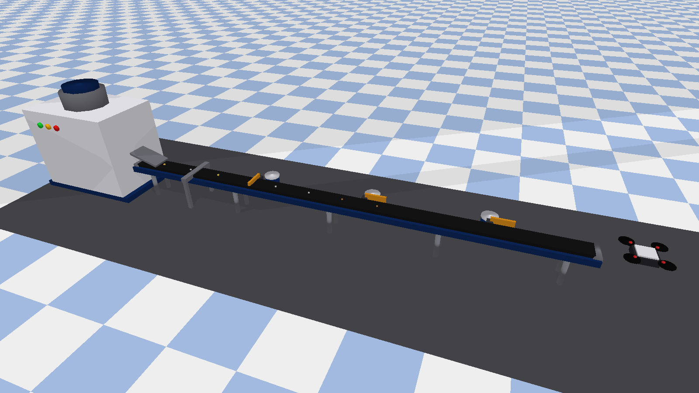
  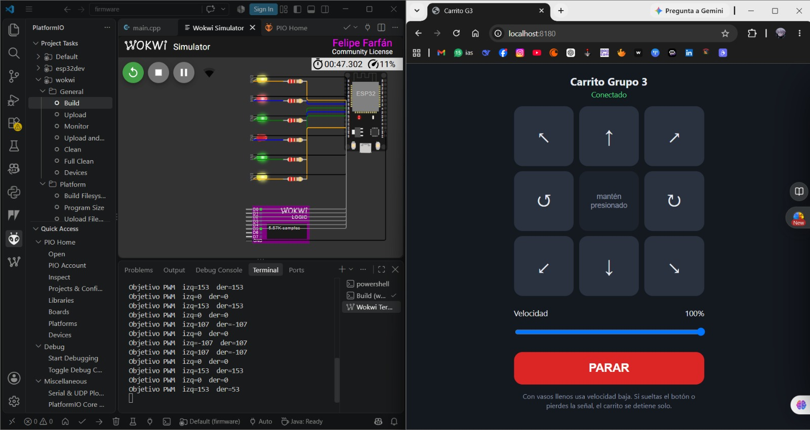
</p>

---

## 8. Conclusiones

- **La ESP32 hizo viable un sistema distribuido de bajo costo.** Cuatro placas de la misma familia, cada una con WiFi,
  PWM por hardware y memoria no volátil, resolvieron cámara, banda, servos, carrito y dron sin un solo cable de datos
  entre módulos. Por eso cada parte se construyó y se probó por separado.
- **Separar el tiempo real del cómputo pesado simplificó todo.** Las ESP32 solo mueven hardware; el PC hace la IA, el
  conteo y la interfaz. Cambiar el modelo, la interfaz o JARVIS nunca obligó a tocar el firmware.
- **Los datos de la propia cámara valen más que muchos datos ajenos.** Tomar las fotos con la ESP32-CAM ya montada,
  etiquetarlas solas y generar mezclas sintéticas dio un detector que funciona en la banda real.
- **La seguridad y la robustez se diseñan desde el firmware:**
  - parada automática del carrito en dos capas;
  - cola sin bloqueo en la S3;
  - alimentación separada para la electrónica de control;
  - un JARVIS que no puede mover el carrito.
- **La alimentación fue la causa de la mayoría de fallas de hardware.** Cámara, carrito y servos se estabilizaron
  alimentando el control aparte de la potencia, con tierra común.
- **El agente JARVIS cierra el sistema.** Une los datos en vivo de todos los módulos con el conocimiento del código y
  del diseño, y los expone por voz a cualquier usuario.

---

## 9. Referencias

- Espressif Systems. *ESP32 / ESP32-S3 / ESP32-C3 Technical Reference Manuals* y *Arduino-ESP32* (LEDC, WiFi, Preferences, mDNS). https://docs.espressif.com
- Espressif Systems. *esp32-camera driver*. https://github.com/espressif/esp32-camera
- Ultralytics. *YOLO11 – Object Detection*. https://docs.ultralytics.com/tasks/detect/
- Google. *Gemini API – Text generation*. https://ai.google.dev/gemini-api/docs/generate-content/text-generation
- Banco de la República. *Guía para el empaque de moneda metálica*. https://banrep.gov.co/es/billetes-monedas/guia-empaque-moneda-metalica-consignar-banco-republica
- Coumans, E. y Bai, Y. *PyBullet Quickstart Guide*.
- FastAPI. https://fastapi.tiangolo.com
- dialejobv. *U_Militar* (modelo URDF base del curso). https://github.com/dialejobv/U_Militar
